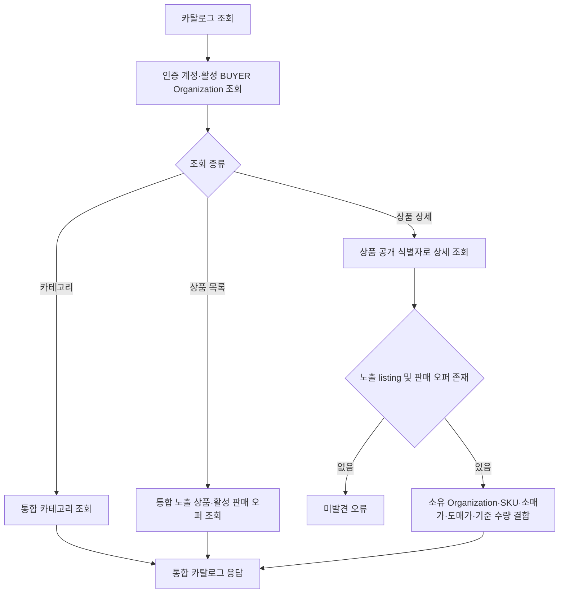
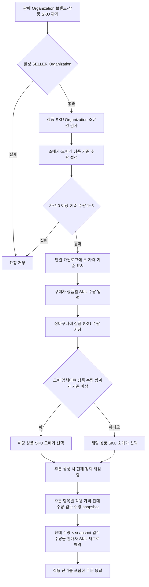

# 카탈로그

## 단일 카탈로그와 상품별 가격 정책

판매 Organization이 브랜드와 상품을 소유하고, 상품의 SKU·이미지·옵션은 해당 상품에 종속. 구매자 유형에 따른 상품 목록 분리 없이 동일 카탈로그 사용. 
`sales_offer`가 판매 Organization·실물 SKU·소매 단가·도매 단가·판매 상태·판매 단위당 입수 수량을 보유. 판매 채널별 기존 카탈로그 데이터는 통합 가격의 원본으로만 사용하며 구매 화면 분기 기준으로 사용하지 않음. 
상품은 `wholesale_minimum_quantity`를 보유하며 허용 범위는 1~5박스. 같은 상품의 여러 SKU 수량을 합산해 기준 도달 여부를 판단. 
도매 업체는 상품별 수량이 기준 이상이면 해당 상품의 각 SKU에 도매 단가 적용. 기준 미달 상품은 소매 단가 적용. 일반 업체와 일반인은 전체 수량과 무관하게 소매 단가 적용. 
기준 수량은 도매 할인 자격만 결정하며 구매를 차단하지 않음. 기준 미달 주문도 소매가로 주문 가능. 

## 공개 조회

### 알고리즘 흐름

- 공개 조회 조건과 응답 구성은 `CatalogService`가 적용하고 `CatalogJpaEntityService`가 조회함. 상품은 소유 Organization에 속한 활성 판매 오퍼가 있는 경우에만 공개 카탈로그에 표시. 
- 관리자 카탈로그 변경 흐름은 [operation.md](operation.md)의 관리자 카탈로그 흐름을 기준으로 함. 

- `GET /api/categories`
- `GET /api/products?page=&size=`
- `GET /api/products/{productId}`

노출 listing과 판매 가능한 오퍼가 있는 조직 소유 상품·SKU만 반환함. 응답은 소매 단가·도매 단가·상품 도매 적용 기준 수량을 포함. 
판매 Organization별 재고 원장은 `organization_id + sku_id`로 구분. 기존 채널 파라미터는 호환 처리하며 구매자 유형과 가격 정책을 분기하지 않음. 

## 관리자 관리

- `GET /api/operation/categories`
- `POST /api/operation/categories`
- `GET /api/operation/brands?page=&size=`
- `POST /api/operation/brands`
- `GET /api/operation/products?page=&size=`
- `GET /api/operation/products/{productId}`
- `POST /api/operation/products`
- `PATCH /api/operation/products/{productId}`
- `PATCH /api/operation/products/{productId}/status`
- `POST /api/operation/products/{productId}/images`
- `POST /api/operation/products/{productId}/options`
- `POST /api/operation/products/{productId}/skus`
- `GET /api/operation/channels/{channel}/categories`
- `POST /api/operation/channels/{channel}/categories`
- `PUT /api/operation/channels/{channel}/products/{productId}/listing`
- `PUT /api/operation/skus/{skuId}/pricing`
- `PUT /api/operation/channels/{channel}/skus/{skuId}/offer` (기존 클라이언트 호환 경로)

## 판매자 판매 관리

- `GET /api/seller/brands?page=&size=`
- `POST /api/seller/brands`
- `GET /api/seller/products?page=&size=`
- `POST /api/seller/products`
- `PATCH /api/seller/products/{productId}`
- `GET /api/seller/products/{productId}`
- `GET /api/seller/skus?page=&size=`
- `PUT /api/seller/skus/{skuId}/pricing`
- `PUT /api/seller/channels/{channelCode}/skus/{skuId}/offer` (기존 클라이언트 호환 경로)
- `GET /api/seller/inventory/skus/{skuId}`
- `PATCH /api/seller/inventory/skus/{skuId}`
- `GET /api/seller/inventory/skus/{skuId}/movements?page=&size=`

판매자 endpoint는 인증 계정의 활성 Organization에 `SELLER` capability가 있는지 확인. 판매 오퍼의 `ON_SALE` 설정과 주문 생성 시에는 완성·대표자 확인된 ACTIVE 사업자 프로필을 추가 검증. 
가격 정책 설정 요청의 가격·수량·상태 범위는 Controller/Request Bean Validation에서 Service 호출 전에 검증. 판매 Organization 소유권과 상태 조합은 Service 업무 검증으로 유지. 기존 채널 offer 경로는 수신한 채널 가격을 해당 통합 가격에 반영하는 호환 경로. 
브랜드와 상품은 판매 Organization 소유. 상품 생성 시 같은 Organization의 브랜드와 채널 카테고리를 사용하며 이미지·옵션·SKU도 그 상품에 종속. 

운영자 카탈로그 API는 소유 Organization이 없는 레거시 상품·브랜드 관리용. 신규 판매 상품·브랜드는 판매자 API에서 생성. 
채널별 listing은 상품마다 채널 카테고리·노출·순서를 관리. 판매 오퍼는 상품 소유 Organization과 일치해야 하며, 오퍼 상태는 상품의 공용 상태를 변경하지 않음. 
별도 SKU 추가 시 옵션값은 해당 상품에 속한 값이어야 함. 재고는 Organization과 SKU별 원장으로 관리하고, 한 Organization의 여러 채널 오퍼가 같은 SKU 원장을 공유. 
HTTP 응답은 response DTO로 변환하며 JPA Entity를 외부 계약에 직접 노출하지 않음. 

## 판매 가격 설정과 구매 흐름

같은 상품 화면에서 SKU별 소매 단가와 도매 단가를 제공. 상품별 도매 기준 수량은 1~5박스 범위에서 운영자가 설정. 
도매 고객은 같은 상품의 SKU 수량 합계가 기준 수량 이상인 경우에만 도매 단가를 적용. 기준 미달 상품은 소매 단가로 구매 가능. 
일반 업체와 일반인은 항상 소매 단가 적용. 요청 채널, UI 계산 가격은 신뢰하지 않고 서버가 현재 조직 유형·상품별 수량·설정 가격으로 재계산. 
소매가·도매가는 동일한 판매 단위당 가격. 판매 단위가 박스일 때 상품별 기준 수량도 박스 수로 계산하며, 주문 항목에 적용 단가와 입수 수량을 snapshot. 

반응형 화면은 공통 상품 정보를 사용하며 앱·웹 각 환경과 역할에 맞는 화면 구성을 제공하는 계획. 
운영자는 앱과 웹에서 주요 업무를 수행할 수 있고, 사용자 웹 이용은 향후 제공을 고려함. 
