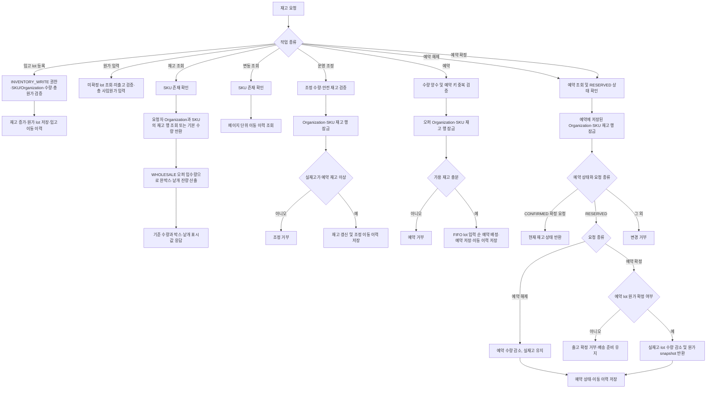
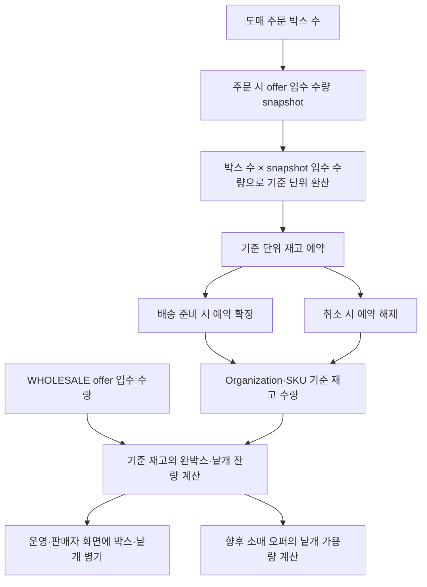

# 재고

## 운영 endpoint

- `GET /api/operation/inventory/skus/{skuId}`
- `PATCH /api/operation/inventory/skus/{skuId}`
- `GET /api/operation/inventory/skus/{skuId}/movements?page=&size=`
- `POST /api/operation/inventory/skus/{skuId}/lots`
- `GET /api/operation/inventory/skus/{skuId}/lots?organizationId=`
- `PUT /api/operation/inventory/lots/{lotId}/cost`

## 판매자 endpoint

- `GET /api/seller/inventory/skus/{skuId}`
- `PATCH /api/seller/inventory/skus/{skuId}`
- `GET /api/seller/inventory/skus/{skuId}/movements?page=&size=`

판매자 endpoint는 인증 계정의 활성 Organization과 `SELLER` capability를 확인하고 Organization별 SKU 원장만 조정·조회. 

## 동작

입고 lot 수량·원가와 원가 입력 요청의 숫자 범위는 Request 모델의 Bean Validation과 Controller `@Valid`에서 확인. Service는 SKU·Organization 일치, lot 상태 및 예약 재고와의 정합성을 확인. 

### 알고리즘 흐름

- 운영 재고 endpoint의 인가 기준은 [operation.md](operation.md)의 권한 매트릭스를 적용. 
- 재고 상태, 예약 상태 및 이동 이력은 하나의 유스케이스 트랜잭션으로 처리. 
- 주문 생성 시 재고와 FIFO lot 수량을 함께 예약. 
  배송 준비 전환 시 lot 원가를 확정하고 주문 품목별 원가 snapshot 저장. 

- 가용 재고는 실재고에서 예약 재고를 뺀 값임. 
- 운영 조정은 재고 이동 이력을 함께 기록함. 
- 주문 생성은 재고를 예약하고 예약 식별자를 주문 항목에 보관함. 
- 예약 확정·해제 use case는 제공됨. 
- 입고 lot 총원가에는 상품대금과 수입정산·관세·부가세 등 변동 부대비용을 합산해 기록. 
- 기존 재고와 수기 양수 조정은 미확정 원가 lot으로 취급. 관리자 원가 등록 전 해당 lot을 소비하는 출고 차단. 
- lot 등록 ID 순 FIFO. 취소 복구 시 소비 수량·원가를 원래 lot으로 복구. 
- 이미 확정된 예약의 확정 요청은 중복 차감 없이 현재 재고를 반환함. 
- 입금 상태와 발송 상태는 독립적으로 관리. 
  미입금 주문에 만료 시각을 두지 않으며 자동 재고 해제도 수행하지 않음. 

`InventoryService`가 `CatalogJpaEntityService`와 `InventoryJpaEntityService`를 직접 호출해 SKU·재고·예약·변동 이력을 처리함. 

## 도매 박스 및 재고 표시 규칙

재고 원장은 판매 Organization·SKU별 기준 단위 수량으로 관리하고, 박스 수와 낱개 잔량 표시는 해당 수량에서 계산. 
박스 입수 수량은 WHOLESALE sales offer에서 설정. 도매 주문의 박스 수는 주문 시점 입수 수량 snapshot을 기준으로 기준 단위로 환산해 예약·확정·해제. 
관리 화면은 완박스 수와 낱개 잔량을 함께 표시하되 두 값을 독립 재고로 저장하지 않음. 
완박스 수는 기준 수량을 입수 수량으로 나눈 몫, 낱개 잔량은 나머지. 실재고·예약·가용 각각에 적용. 

박스 환산은 고객이 선택하는 판매 단위 변경이 아니라 서버의 재고 계산 규칙. 
실재고 원장과 표시용 환산값을 분리 저장해 합계 불일치 방지. 
입수 수량 변경은 기존 주문·예약에 영향을 주지 않도록 주문 항목의 판매 단위 snapshot을 보존. 
